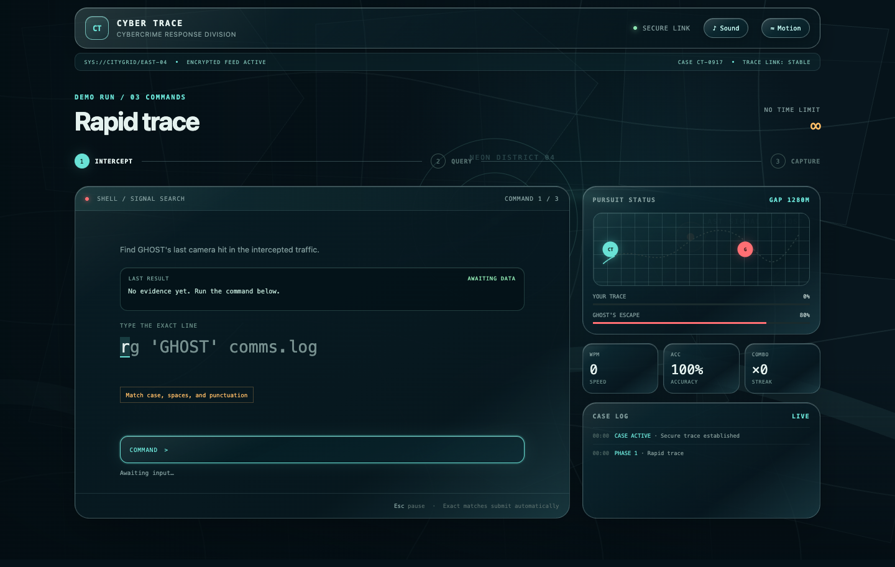

# Cyber Trace

**A cinematic, keyboard-first investigation game.** Track a suspect through intercepted logs, traffic cameras, and a final field operation by typing realistic command-shaped lines.



## Play locally

Requires Python 3 to serve the static files. No install, build step, backend, account, or external assets are needed.

```bash
npm start
```

Open [http://localhost:4173](http://localhost:4173). You can also run `python3 -m http.server 4173` directly.

The displayed commands are **game prompts only**. They are simulated in the browser and are never executed on your computer.

## How to play

1. Pick **Demo**, **Rookie**, **Operative**, or **Expert**.
2. Watch or skip the short mission briefing.
3. Type each displayed command exactly. Correct commands submit automatically and reveal the next clue.
4. Complete the trace before GHOST escapes. A successful run ends with a map-to-custody cinematic and a case report.

**Demo** has no time limit and takes exactly three correct commands to capture GHOST. The other modes adjust time, pursuit pressure, and score multiplier.

| Key | Action |
| --- | --- |
| `Enter` | Open the briefing, begin the mission, advance phases, or replay |
| `Esc` | Skip the briefing, then pause or resume during play |
| Type | Enter the displayed command; exact matches submit automatically |

Sound and motion can be toggled in the interface. The game also respects the system's reduced-motion preference.

## Project structure

| Path | Purpose |
| --- | --- |
| `index.html` and `styles.css` | Interface, cinematic layout, and visual effects |
| `src/app.js` | Browser interactions and sequence timing |
| `src/engine.js` | Game rules, difficulty settings, and scoring |
| `assets/` | Original, locally stored cinematic images |
| `tests/` | Game-engine tests |

Run the tests with `npm test` (Node.js required).

## Design notes

The opening briefing lasts about 9.5 seconds. The successful capture sequence lasts about 13.4 seconds, moving from an overhead trace to two progressively closer images. Both sequences can be skipped. Reduced-motion mode presents a static frame.

All game text is in English. The command input deliberately resembles shell, SQL, and dispatch code, while the evidence and outcome are fictional.
